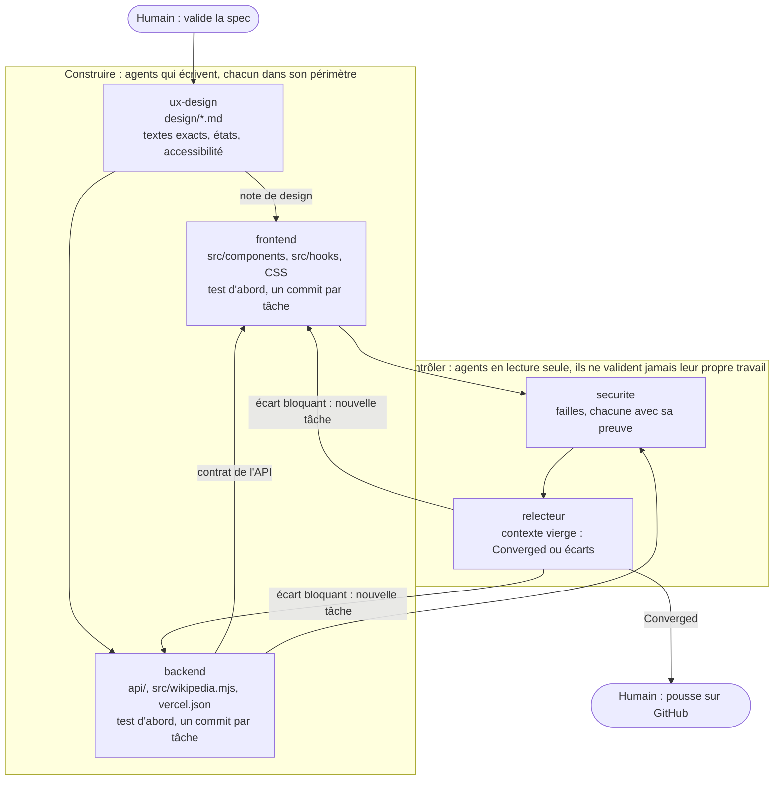

# Podium Dakar 2026 — résultats des JOJ, en français, sur mobile

**Le problème et pour qui** : pendant les JOJ Dakar 2026, un supporter ou un journaliste doit passer d'une source à l'autre pour savoir qui a gagné, où en est son pays et ce qui se joue maintenant ; Podium Dakar rassemble seul les vrais résultats, le tableau des médailles et les épreuves en direct.
**Lancer** : Node 20 ou plus (`nvm use`), `npm install` puis `npm run dev` (http://localhost:5173) ; `npm run check` pour les types, les 51 tests et le build. En ligne : https://resultat-joj-jugu.vercel.app
**Ce qui manque** : de vrais comptes de chefs de site (un compte de démonstration les remplace), et le partage entre appareils des podiums saisis dans l'application.

> **Réalisé pendant le Bootcamp AI Programming d'Artefact (Dakar, novembre 2026), avec Claude Code.** Équipe : Silamaka Diallo (analyste de données), Daouda KA (ingénieur en informatique, spécialité Business Intelligence), Papa Malick Teuw (ingénieur développeur Full Stack & Data, conception et développement).

Travail de la formation, construit avec la même méthode (PRD, specs, test d'abord, relecture indépendante) : [formation-joj, branche atelier-c](https://github.com/MalickDevWeb/formation-joj/tree/atelier-c).

---

## Ce que fait l'application

- **Résultats réels** des 25 sports, lus sur Wikipédia : podium complet = officiel, sinon « à venir ».
- **Tableau des médailles**, celui de Wikipédia, corrigé des podiums saisis dans l'application.
- **En direct** : les épreuves en cours, lues chaque minute sur le programme officiel des Jeux, avec score et lieu.
- **Toujours à jour, sans redéployer** : chaque navigateur relit Wikipédia toutes les 6 heures ; si rien ne répond, les derniers résultats restent.
- **Résumé du jour, rédigé par Claude** : les finales officielles du jour deviennent quelques paragraphes pour les journalistes, avec les podiums sur lesquels ils s'appuient.
- **Chef de site** : publier un podium (provisoire), le faire valider (officiel), le rectifier avec un motif (l'ancienne version reste visible).
- **PWA** : installable, en français, utilisable hors connexion.

Compte de démonstration du chef de site : `admin123joj@gmail.com` / `joj1234` (vérifié dans le navigateur, ce n'est pas une vraie sécurité).

## Comment c'est construit

Le produit est décrit dans [`specs/prd-podium-dakar.md`](specs/prd-podium-dakar.md), découpé en tranches. Chaque tranche réalisée a sa spec, et chaque scénario de la spec a son test, dont le titre commence par l'identifiant du scénario (`001-AS3`, `003-AS1`…).

| Tranche | Spec | Tests | Code |
| --- | --- | --- | --- |
| TR1 Résultats réels | [`001-resultats-wikipedia`](specs/001-resultats-wikipedia/spec.md) | `tests/001-*.test.ts` | `src/wikipedia.mjs` |
| TR2 Tableau des médailles | [`002-tableau-medailles`](specs/002-tableau-medailles/spec.md) | `tests/002-*.test.ts` | `medalTable` dans `src/data.ts` |
| TR3 En direct | [`003-en-direct`](specs/003-en-direct/spec.md) | `tests/003-*.test.ts` | `api/live.js`, `src/hooks/useLive.ts` |
| TR4 Mise à jour sans perte | [`004-mise-a-jour`](specs/004-mise-a-jour/spec.md) | `tests/004-*.test.ts` | `src/hooks/usePodiumStore.ts` |
| TR5 Résumé par Claude | [`005-resume-du-jour`](specs/005-resume-du-jour/spec.md) | `tests/005-*.test.ts` | `api/resume.ts`, `src/components/DaySummary.tsx` |

Les tests n'appellent jamais le réseau ni Claude : Wikipédia, le site officiel et le rédacteur sont remplacés par des faux, dont des extraits réels du programme officiel (`tests/fixtures/`).

## Équipe d'agents Claude Code

Cinq agents, définis dans `.claude/agents/`, construisent chaque tranche, chacun dans son périmètre :



| Agent | Rôle | Seul à modifier |
| --- | --- | --- |
| `ux-design` | note de design de l'écran (textes exacts, états, accessibilité) | `design/*.md` |
| `backend` | fonctions Vercel, lecture des sources, test d'abord | `api/`, `src/wikipedia.mjs`, `scripts/`, `vercel.json` |
| `frontend` | écrans fidèles au design, test d'abord | `src/components/`, `src/hooks/`, `src/index.css`, `src/sw.ts` |
| `securite` | audit des failles, avec preuve | rien (lecture seule) |
| `relecteur` | verdict indépendant sur la spec | rien (lecture seule) |

Celui qui produit ne valide pas : `securite` et `relecteur` n'ont aucun outil d'écriture.

**Essai réel (12 novembre 2026)**, dans une copie isolée du dépôt :

- `backend` et `frontend` ont chacun fait leur tâche test d'abord, un commit chacun, et **refusé** une demande glissée hors de leur périmètre.
- `ux-design` a relevé trois défauts d'accessibilité, dont un contraste de 2,4:1 sur la médaille d'or.
- `securite` a trouvé **une faille haute, preuve à l'appui** : 20 requêtes simultanées faisaient 20 appels payants à Claude. Elle est corrigée (test `005-AS10`) et revérifiée.
- `relecteur` a bloqué un fichier hors périmètre glissé dans le changement.

Le détail est dans [`docs/equipe-agents.md`](docs/equipe-agents.md) ; `tests/agents.test.ts` vérifie les garde-fous de chaque agent à chaque `npm run check`.

## Claude dans l'application

`GET /api/resume?jour=2026-11-11` renvoie le résumé des médailles d'une journée. Claude (`claude-opus-5-5`, réponse JSON validée par un schéma Zod) rédige ; l'application garde les règles :

- Claude ne reçoit que les finales officielles du jour, lues côté serveur : aucun texte venu d'un visiteur ne lui est transmis.
- Une journée sans podium répond 404 sans appeler Claude ; une épreuve citée par Claude qui n'existe pas est écartée.
- Seuls les jours des Jeux sont acceptés, sans autre paramètre, et le résumé est gardé en cache (24 h pour un jour passé, 30 min pour le jour même) : impossible de multiplier les appels pour consommer les crédits.
- En cas de refus, le serveur réessaie sur le modèle recommandé (`fallbacks: "default"`).

**Configurer la clé** : dans Vercel, *Settings → Environment Variables*, ajouter `ANTHROPIC_API_KEY`, puis redéployer. La clé n'est jamais dans le code ni envoyée au navigateur. Sans clé, le résumé affiche « momentanément indisponible ».

## Sécurité

- En-têtes sur tout le site (`vercel.json`) : CSP stricte (aucun script externe ni en ligne), HSTS, interdiction d'être affiché dans un cadre, `nosniff`, `Referrer-Policy`, `Permissions-Policy`.
- Les fonctions serveur ne prennent aucune adresse en paramètre (pas de SSRF) et valident tout ce qu'elles reçoivent ; un lien du site officiel ne peut pas mener ailleurs (test `003-AS8`).
- Les données reçues sont vérifiées avant affichage ; React échappe tout le texte ; les seuls SVG injectés sont des constantes du code.
- `npm audit --omit=dev` : aucune vulnérabilité dans ce qui est livré aux visiteurs.
- Le compte de chef de site est un compte de démonstration vérifié dans le navigateur : il ne protège rien, car les podiums saisis restent dans le navigateur de celui qui les saisit.

## Commandes

| Commande | Effet |
| --- | --- |
| `npm run dev` | serveur de développement (sert aussi `/api/live` et `/api/resume`) |
| `npm test` | les tests (Vitest) |
| `npm run check` | types, tests et build : tout doit être vert avant un commit |
| `npm run import:wiki` | enregistre une copie des résultats dans `src/resultats.json` (lancé avant `dev` et `build`) |

## Structure

```
api/live.js                 fonction Vercel : épreuves en cours, lues sur le programme officiel
api/resume.ts               fonction Vercel : résumé du jour rédigé par Claude
src/wikipedia.mjs           lecture de Wikipédia (navigateur et script)
src/data.ts                 types, tableau des médailles
src/hooks/usePodiumStore.ts données des podiums, mise à jour toutes les 6 h
src/hooks/useLive.ts        épreuves en direct, rafraîchies chaque minute
src/components/             écrans
scripts/import-wikipedia.mjs copie de secours des résultats
specs/                      PRD et specs
tests/                      un fichier de tests par spec
```

## Sources des données

- Résultats et médailles : [Wikipédia](https://en.wikipedia.org/wiki/2026_Summer_Youth_Olympics), licence CC BY-SA 4.0 (attribution affichée dans l'application).
- Épreuves en cours et finales du jour : [résultats officiels Dakar 2026](https://webresult.apps.dakar2026.org/hide/en/).
- Résumé du jour : rédigé par Claude (Anthropic) à partir de ces résultats officiels.
